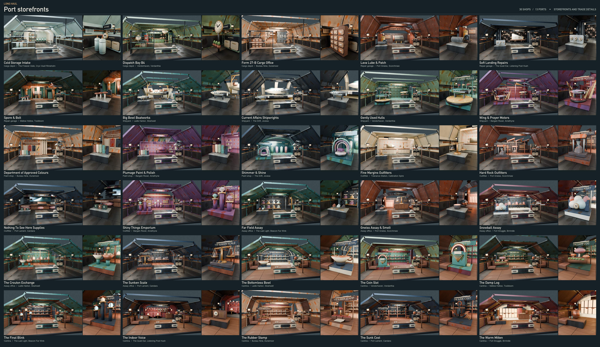
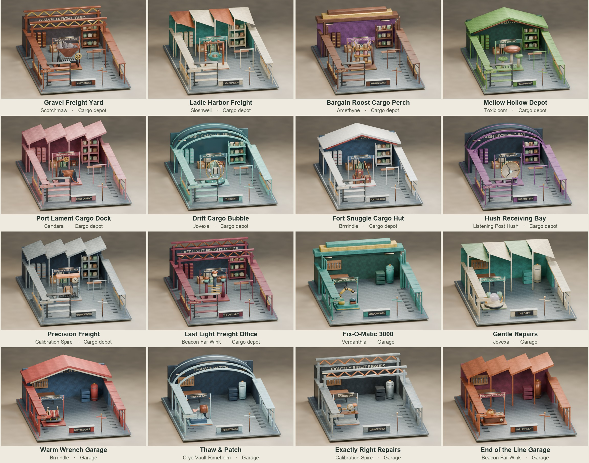
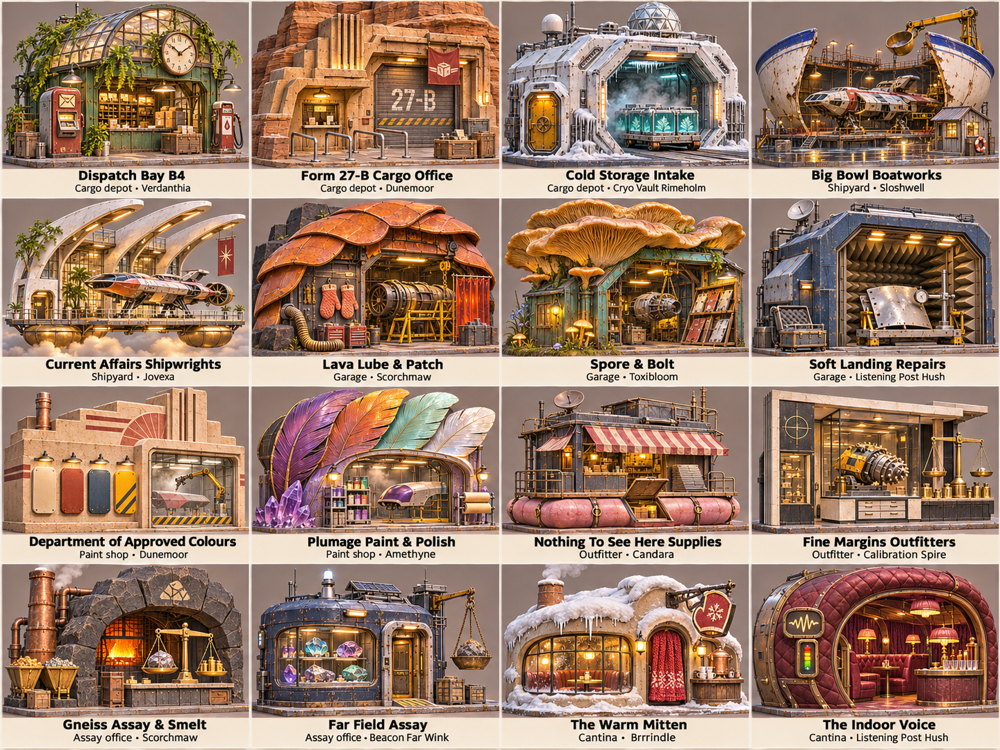

# Long Haul storefront models

All 46 shops across nine planets and four research stations have an individually editable, open-front storefront. Thirty of them use the Rustbucket’s surface library. Each pair on the sheet below shows the public approach and a close inspection of the trade display, both rendered in Cycles from the individually saved Blender project. The other sixteen are the freight depots and garages further down. Names, locations, services and shop keys come from the [game venue definitions](../../../src/08b-venues.js).

[Open the full-resolution proof sheet](port-shop-remodels.jpg)



## Models and game integration

- [Individual Blender projects](../../../art/storefronts/models/) and [game GLBs and manifest](../../../assets/storefronts/)
- [Original sixteen, master Blender project](../../../art/storefronts/Long-Haul-Storefronts.blend) and [fourteen market additions, master Blender project](../../../art/storefronts/Market-Storefronts.blend)
- [Shop-to-port list and marker guide](shop-to-port.md)

Stand at the counter to see the new work. Each port has its own hull frame and enamel finish. Cantinas have leather booths and curved brass lamp arms, paint shops have extraction hoods and hanging swatches, and engine shops have inspection couplings and rail-mounted lifting gear. Packed colour, normal and roughness textures come from the same surface recipes as the ship interiors. The three practical light positions in each manifest entry also drive the native Blender lights.

The game resolves a shop by its existing location and shop key. The entrance, camera, keeper, crew, customer and nameplate sockets retain their original positions. Depots retain the twelve shelf positions, stock door, packing bench and cargo droid route. Keep purchases, contracts, repairs, drinks and character actions on the existing game handlers. `?oldshops` retains the existing comparison mode. The three remodeled depot wayfinding signs hang above the cargo lane so the droid clears the turn in front of the shelves.

## Sixteen freight depots and garages

[Final ten depots and six garages in Blender](../../../art/storefronts/Freight-Storefronts.blend) · [Full-resolution render sheet](freight-storefronts.jpg)



These ten depots keep the navigation mast, so their droid takes the outer aisle to reach the goods shelf. They have not had the Rustbucket surface pass.

## Rebuild the models and proof

Run from the repository root with Blender 4.5 LTS and a Python installation with Pillow. Build the two model collections sequentially because they share the game manifest.

```sh
blender -b --factory-startup --python-exit-code 1 -P art/storefronts/build.py -- "$PWD"
blender -b --factory-startup --python-exit-code 1 -P art/storefronts/build.py -- "$PWD" --expansion
blender -b --factory-startup --python-exit-code 1 -P art/storefronts/proof_views.py -- "$PWD" "$PWD/build/port-shop-remodels"
blender -b --factory-startup --python-exit-code 1 -P art/storefronts/proof_views.py -- "$PWD" "$PWD/build/port-shop-details" --details
python3 art/storefronts/proof_sheet.py build/port-shop-remodels build/port-shop-details docs/interiors/storefronts/port-shop-remodels.jpg
blender -b --factory-startup --python-exit-code 1 -P art/storefronts/build.py -- "$PWD" --freight --render
bash build.sh
node tools/check-assets.mjs
```

The optional `--render` pass of the freight build writes individual views under `build/freight-renders/`. Earlier model sheets document the previous pass on the [original sixteen](storefront-model-proof.jpg) and the [fourteen additions](market-storefronts.jpg).

## Original venue concept sheet



## Guide for Claude

Use the venue sheet as the exterior design reference. Match a panel by location and shop key when working on a port. The silhouette and the equipment at the entrance are what distinguish two shops with the same function. For example, Sloshwell displays its ship in a bowl-shaped drydock, while Jovexa displays one on an open platform floating above the clouds.

The [port-interior handoff](../../handoff-bespoke-interiors.md) documents the existing interaction anchors for depots, garages and cantinas. The exterior assets have their own manifest.

| Panel | Business | Location | Shop type and key | Visible design feature |
| --- | --- | --- | --- | --- |
| 1.1 | Dispatch Bay B4 | Verdanthia | Cargo depot (`depot`) | Glazed potting shed with a dispatch clock and a vending-machine contract slot. |
| 1.2 | Form 27-B Cargo Office | Dunemoor | Cargo depot (`depot`) | Canyon-cut civic office with queue rails and a freight shutter marked 27-B. |
| 1.3 | Cold Storage Intake | Cryo Vault Rimeholm | Cargo depot (`depot`) | Frosted pressure lock with a specimen trolley on the loading apron. |
| 1.4 | Big Bowl Boatworks | Sloshwell | Shipyard (`yard`) | Split enamel bowl drydock with a ladle hoist over the display ship. |
| 2.1 | Current Affairs Shipwrights | Jovexa | Shipyard (`yard`) | Swept showroom ribs and brass pontoons above the cloud line. |
| 2.2 | Lava Lube & Patch | Scorchmaw | Garage (`garage`) | Overlapping ceramic heat shields cover an engine jack and a welder’s mitts. |
| 2.3 | Spore & Bolt | Toxibloom | Garage (`garage`) | Bracket fungi shelter an engine hoist and a rack of hull plates. |
| 2.4 | Soft Landing Repairs | Listening Post Hush | Garage (`garage`) | Acoustic wedges frame a dented hull plate on a measuring jig. |
| 3.1 | Department of Approved Colours | Dunemoor | Paint shop (`livery`) | A civic spray booth displays regulation paint swatches like official notices. |
| 3.2 | Plumage Paint & Polish | Amethyne | Paint shop (`livery`) | Feather-shaped painted panels fan out over a partly painted cowling. |
| 3.3 | Nothing To See Here Supplies | Candara | Outfitter (`outfit`) | An ordinary counter on pink pontoons conceals a false-floor compartment at the threshold. |
| 3.4 | Fine Margins Outfitters | Calibration Spire | Outfitter (`outfit`) | A ship-fitting showroom pairs a mining head with precision scales. |
| 4.1 | Gneiss Assay & Smelt | Scorchmaw | Assay office (`assay`) | A basalt arch frames a working furnace and the public ore scale. |
| 4.2 | Far Field Assay | Beacon Far Wink | Assay office (`assay`) | A pressure-hull kiosk displays rare ore beside a hanging weigh pan. |
| 4.3 | The Warm Mitten | Brrrindle | Cantina (`bar`) | A cocoa counter glows through a snow-covered bow window beside the knitted entry curtain. |
| 4.4 | The Indoor Voice | Listening Post Hush | Cantina (`bar`) | A quilted pressure vestibule opens onto padded booths and shaded lamps. |

## Original style study

[Open the first exploratory sheet](original-storefront-study.png). Its sixteen invented businesses established the miniature scale, weathered materials, practical lighting and label treatment used in the venue sheet. Use the venue sheet above for the in-game business lineup.
