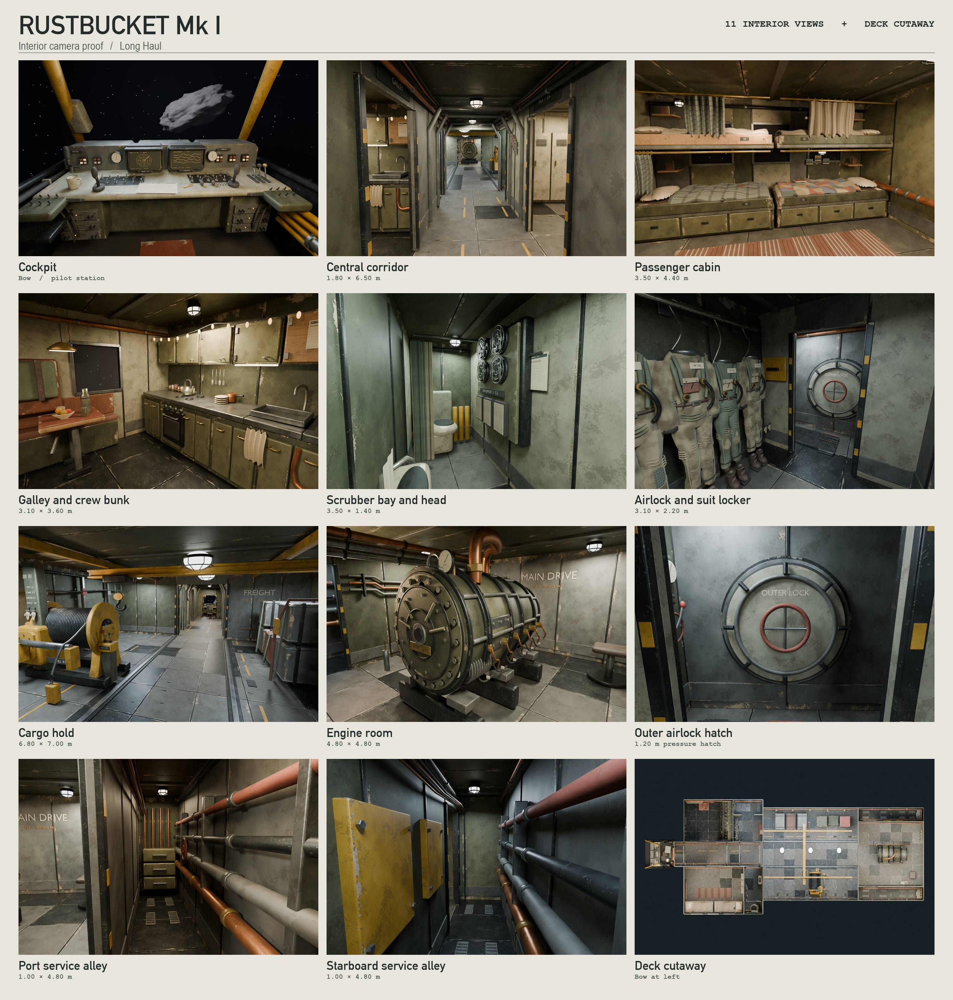
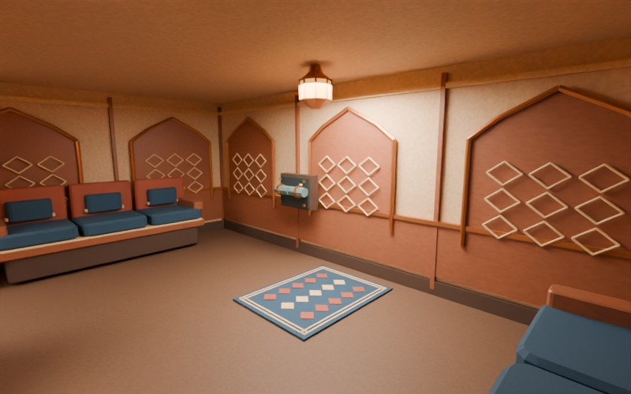
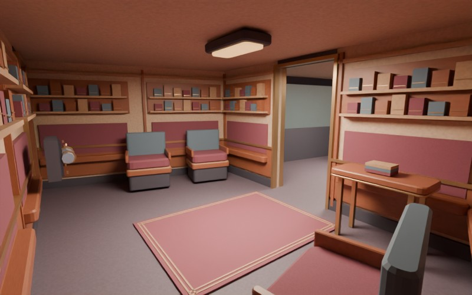
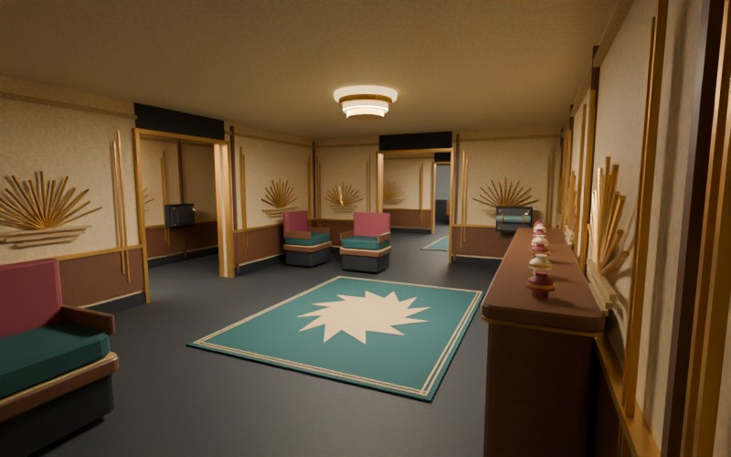
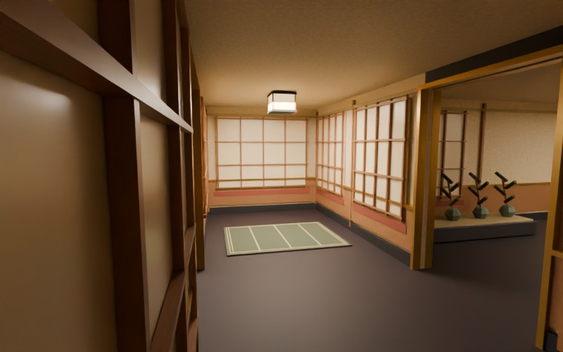

# Walkable ship interiors

Open the [fleet blueprints and repair-model handoff](fleet-blueprints/README.md) for the four fitted ships, their dimensioned drawings and the Rustbucket repair models.

The lived-in redesign of each deck is described in [the deck briefs](briefs.md).

The complete fleet archive includes the native Blender scenes, game models, ship manifests and full-size views. Open `gallery.html` after extraction.

## Rustbucket Mk I

The fitted Rustbucket has a welded cockpit, stacked dayberths, and a working cargo gantry. The [cutaway](rustbucket/fitted/deck-cutaway.jpg) shows how the rooms connect. The [repair fittings](rustbucket/repair-states.jpg) show working, broken and repaired states for the seven fault stations.

[Individual room renders and original Rustbucket blueprint](rustbucket/fitted/)

## Dromedary 400

Facing divans and brass coffee service occupy the raised residential deck above the freight hold.

[Deck cutaway](dromedary/deck-cutaway.jpg) · [Editable Blender model](../../art/ship-interiors/dromedary.blend)

## Stellar Stoat

Two bypass passages connect the book-lined captain’s wardroom to the turbine room around a sealed freight pod.

[Deck cutaway](stoat/deck-cutaway.jpg) · [Editable Blender model](../../art/ship-interiors/stoat.blend)

## Opulent Manatee

The first-class salon and observation lounge share the promenade deck. Two lifts connect it to the working deck.

[Deck cutaway](manatee/deck-cutaway.jpg) · [Editable Blender model](../../art/ship-interiors/manatee.blend)

## Quasar Empress

The moon court, tea salon and lacquered guest suites occupy the state deck above the two cargo vaults.

[Deck cutaway](empress/deck-cutaway.jpg) · [Editable Blender model](../../art/ship-interiors/empress.blend)
